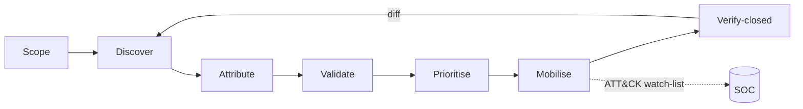

# outside-in

**See your enterprise the way an attacker's scanner does, then close what matters.**


> **TL;DR**: An EASM-led exposure-management toolkit for CTEM programmes. It finds **exposed services** and
> **exposed cloud assets**, proves they're real without touching data, ranks them, and mobilises fixes to the right
> owners. A SOC watch-list mapped to MITRE ATT&CK v20.1 covers the gap while each fix is in flight.

By **[d6falcon](https://github.com/d6falcon)**

## Why

- **Exploits are now the #1 way in.** In Google Cloud, software-based entry reached **44.5%** of initial access,
  ahead of weak credentials at **27.2%** (*Threat Horizons H1 2026*). Exploitation is #1 in Verizon DBIR 2026 too.
- **The window is days, not weeks.** Attackers deployed miners **~48 hours** after a critical CVE was disclosed.
- **Lists don't fix anything.** Most programmes stall on *is it ours, is it real, who fixes it by when?*

[Evidence and sources →](RESEARCH.md)

## How



| Step | What's different |
|---|---|
| **Attribute** | Every asset is A1 confirmed, A2 probable or A3 unattributed, so nobody is paged for someone else's bucket. Exposed hosts missing their EDR agent are flagged as blind spots |
| **Validate** | Least-touch evidence only: a status code or key *name*. No exploits, no data reads, no found credentials |
| **Prioritise** | **EPS** = Reach + Class + Pressure + Blast (0–100 → P1–P4). Transparent, and runs alongside your prioritisation engine |
| **Mobilise** | Remediation campaigns with ITSM tickets, SLAs and exceptions, plus an org-level guardrail per class |

[Methodology →](docs/methodology.md) · [Operating model →](docs/operating-model.md) · [Design decisions →](docs/architecture-decisions.md)

**See it end to end:** [a public GCS bucket with customer data, from discovery to `closed-verified` →](docs/examples/gcs-public-bucket.md)

## What's inside

| | |
|---|---|
| **3 skills** | [exposed-services](skills/exposed-services/SKILL.md) · [exposed-cloud-assets](skills/exposed-cloud-assets/SKILL.md) · [exposure-triage](skills/exposure-triage/SKILL.md) |
| **129 exposure classes** | [86 services](catalog/services.yaml) (RDP, VPNs, databases, Kubernetes, AI/MCP, OT…) and [43 cloud](catalog/cloud-assets.yaml) (buckets, snapshots, serverless, leaked keys, dangling DNS…) |
| **2 runbooks** | [RB-01 Exploited internet-facing software](runbooks/RB-01-exploited-internet-facing-software.md) · [RB-02 Weak, leaked or stolen credentials](runbooks/RB-02-weak-leaked-stolen-credentials.md), together covering **~72%** of observed cloud initial access |
| **ATT&CK v20.1** | Every cited technique and detection strategy is validated against MITRE's STIX data by [one script](scripts/update_attack_mapping.py) |
| **Templates** | [Campaign](templates/remediation-campaign.md) · [Owner ticket](templates/owner-ticket.md) · [Exec brief](templates/exec-brief.md) · [Finding schema](schemas/finding.schema.json) |

## Quick start

```bash
git clone https://github.com/d6falcon/outside-in.git && cd outside-in
```

Open it in an AI coding assistant that reads `SKILL.md` files (for example Claude Code), then ask:

> *"Build a passive exposure inventory for 203.0.113.0/24 and example.com, then prioritise and group the findings
> into remediation campaigns."*

Everything is also plain Markdown and YAML that a human analyst can follow without an assistant.
[Install for all projects, and refresh ATT&CK →](docs/install.md)

## Ground rules

Use it only on assets you own or are authorised to assess. Active probing needs written sign-off.
[Rules of engagement →](docs/methodology.md#rules-of-engagement)

---

Inspired by [elementalsouls/Claude-OSINT](https://github.com/elementalsouls/Claude-OSINT); no content copied
([credits](CREDITS.md)). MITRE ATT&CK® is a trademark of The MITRE Corporation. [MIT](LICENSE) © 2026 d6falcon ·
third-party terms in [NOTICE](NOTICE).
