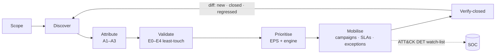

# outside-in

**See your enterprise the way an attacker's scanner does, then close what matters.**


An EASM-led exposure-management toolkit for **defenders** running a CTEM programme. It takes on the two burning issues
behind most of today's initial access, **exposed services (common ports)** and **exposed cloud assets**, and turns raw
outside-in findings into owned, validated, prioritised and **mobilised** remediation, with a SOC watch-list mapped to
**MITRE ATT&CK® Enterprise v20.1**.

Designed and maintained by **[d6falcon](https://github.com/d6falcon)**.

---

## The problem

Attack-surface tools are good at producing lists. Programmes stall at the next three questions: *is it really ours,
is it really exposed, and who is going to fix it by when?* Meanwhile the exploitation window has collapsed:

| Signal (2026 reporting) | What it says |
|---|---|
| **Google Cloud Threat Horizons H1 2026** | In Google Cloud, **software-based entry (44.5%)** overtook **weak or absent credentials (27.2%)** for the first time. Misconfiguration 21.0%, exposed sensitive UI/API 4.9%. Across platforms, **identity underpinned 83%** of cloud and SaaS intrusions and **data theft was the goal in 73%**. Disclosure to mass exploitation: **weeks → days**. |
| Verizon DBIR 2026 | Exploitation is the **#1 initial-access vector (~31%)**. Access brokers mostly sell **VPN (44%)** and **remote-desktop (35%)** access. |
| Mandiant M-Trends 2026 | Exploits top the initial-infection list for the **6th year (32%)**. Mean time-to-exploit is **negative (~-7 days)**. |
| Arctic Wolf 2026 | **65%** of non-BEC IR cases came through **external remote access** (RDP, VPN, RMM). |
| Flare / Ransomnews 2026 | 200k+ exposed MongoDB servers. ~46% of exposed databases studied already carried a ransom or wipe note. |
| CSA / Censys 2026 | Tens of thousands of **self-hosted AI endpoints** (Ollama, vLLM, MCP servers) are exposed, and few have authentication. |

Full evidence, sources and caveats: [RESEARCH.md](RESEARCH.md).

---

## How it works

One loop, aligned to the five CTEM stages ([methodology](docs/methodology.md)):



| What makes it different | |
|---|---|
| **Attribution is its own axis** | A1 confirmed / A2 probable / A3 unattributed. Nobody gets paged for someone else's bucket, and shadow IT becomes a measurable output. |
| **Least-touch evidence ladder** | E0 reported → E1 reachable → E2 identified → E3 unauthenticated access (status code or key *name* only) → E4 owner-confirmed. No exploits, no data reads, no found credentials. |
| **Outside-in, confirmed inside-out** | Every cloud class ships a read-only `aws` / `az` / `gcloud` command for the owner, plus a *stranger-account* view that proves public sharing without touching data. |
| **Transparent priority** | **EPS** = Reach + Class + Pressure + Blast (0–100 → P1–P4). It runs next to your prioritisation engine and feeds it the outside-in facts it usually lacks. |
| **Mobilise, don't just ticket** | Findings roll up by root cause into **remediation campaigns** with ITSM tickets, SLAs and an exception path that requires a Reach-reducing compensating control. |
| **Close the class** | Each cloud class carries an org-level **guardrail** (SCP / declarative policy, Azure Policy, GCP org policy). Regressions lift a band. |
| **ATT&CK as the hand-off** | Each class lists the techniques it enables and the **Detection Strategies (DETxxxx)** the SOC must cover while it is open. IDs are generated from MITRE's STIX bundle and machine-validated. |

The reasoning behind each choice is recorded as [architecture decision records](docs/architecture-decisions.md).

---

## At a glance

| | |
|---|---|
| **Skills** | 3: `exposed-services`, `exposed-cloud-assets`, `exposure-triage` |
| **Exposure classes** | **129**: 86 service classes (remote admin, edge appliances, BMC/hypervisors, databases, brokers, containers, DevOps, AI/MCP, OT) + 43 cloud classes (storage, snapshots, DBaaS/BaaS, serverless, Kubernetes, firewall drift, dangling DNS, non-human identities, SaaS links, cloud AI) |
| **ATT&CK coverage** | Full Enterprise v20.1 technique table (706 techniques and sub-techniques) with detection strategies and mitigations. Every ID cited in the repo is validated as active |
| **Runbooks** | 2 deep response runbooks for the top two Threat Horizons vectors (~72% of observed cloud initial access) |
| **Integration** | JSON finding schema, campaign / ticket / exec-brief templates, vendor-neutral [operating model](docs/operating-model.md) with data sources and RACI |

---

## Repository layout

```
outside-in/
├── skills/
│   ├── exposed-services/SKILL.md           # ports & services: discover → validate → hand to triage
│   ├── exposed-cloud-assets/SKILL.md       # storage, snapshots, DBaaS, serverless, K8s, identities, AI
│   └── exposure-triage/SKILL.md            # attribution, EPS, campaigns, SOC hand-off, verify-closed, diff
├── catalog/
│   ├── services.yaml                       # 86 service exposure classes
│   ├── cloud-assets.yaml                   # 43 cloud exposure classes (+ inside-out checks, guardrails)
│   └── attack-enterprise.tsv               # generated: ATT&CK v20.1 technique → tactics → DET → mitigations
├── runbooks/
│   ├── RB-01-exploited-internet-facing-software.md   # Threat Horizons #1: software-based entry (44.5%)
│   └── RB-02-weak-leaked-stolen-credentials.md       # Threat Horizons #2: weak/absent creds (27.2%), identity 83%
├── docs/
│   ├── methodology.md                      # loop, rules of engagement, attribution, evidence ladder, EPS, mobilisation
│   ├── operating-model.md                  # where it sits in a CTEM programme: data sources, RACI, cadence, metrics
│   ├── architecture-decisions.md           # ADR-001 … ADR-008
│   └── attack-mapping.md                   # exposure → attack-chain matrix, DET hand-off worked example
├── schemas/finding.schema.json             # one finding = one JSON object (engine / SIEM / ITSM friendly)
├── templates/                              # remediation campaign · owner ticket · exec brief
├── scripts/Update-AttackMapping.ps1        # regenerate the ATT&CK table from MITRE STIX and validate every cited ID
├── RESEARCH.md                             # problem validation with 2026 sources
├── RUNBOOKS-BACKLOG.md                     # next runbooks, ranked by Threat Horizons weight
└── CREDITS.md · CHANGELOG.md · LICENSE
```

### Skills

The skills use the open `SKILL.md` format read by AI coding assistants such as Claude Code. Each one is a short,
procedural playbook that reasons over the catalogs. Methodology, catalogs and runbooks are plain Markdown and YAML,
and are just as usable by a human analyst.

| Skill | Ask it… | You get |
|---|---|---|
| **exposed-services** | "What's listening on our public ranges?", "Is RDP exposed anywhere?", "Validate this Shadowserver report" | Attributed, least-touch-validated findings mapped to the catalog |
| **exposed-cloud-assets** | "Find our public buckets and snapshots", "Is our EKS/AKS/GKE API public?", "Any MCP or Ollama endpoints exposed?" | Outside-in evidence + the owner's inside-out command + the org guardrail |
| **exposure-triage** | "Prioritise these 40 findings", "Build a campaign for exposed RDP", "Is it actually fixed?" | EPS bands, remediation campaigns, ITSM-ready tickets, SOC DET watch-list, verify-closed and diff |

### Runbooks

| Runbook | Trigger | Built around |
|---|---|---|
| [RB-01 Exploited internet-facing software](runbooks/RB-01-exploited-internet-facing-software.md) | A CVE in something we expose is exploited, or post-exploitation is seen on an internet-facing workload | Virtual patch < 24h · full patch < 72h · preserve before touch · hunts for web shells, miners, metadata-credential theft, K8s persistence |
| [RB-02 Weak, leaked or stolen credentials](runbooks/RB-02-weak-leaked-stolen-credentials.md) | Weak login, leaked secret, abused CI/CD OIDC or OAuth trust, human account takeover | Attribute without using the secret · reversible containment per credential type · hunt from exposure time · guardrails for non-human identities |

---

## Getting started

Clone the repo and work from its root. Skills, catalogs and docs resolve relative to it.

```bash
git clone https://github.com/d6falcon/outside-in.git
cd outside-in
```

To make the skills available in every project of an AI coding assistant that reads `SKILL.md` (for example Claude
Code's user skills folder):

```bash
cp -r skills/* ~/.claude/skills/
mkdir -p ~/.claude/skills/outside-in-kb && cp -r catalog docs schemas templates runbooks ~/.claude/skills/outside-in-kb/
```

```powershell
Copy-Item -Recurse skills\* "$HOME\.claude\skills\"
New-Item -ItemType Directory -Force "$HOME\.claude\skills\outside-in-kb" | Out-Null
Copy-Item -Recurse catalog, docs, schemas, templates, runbooks "$HOME\.claude\skills\outside-in-kb\"
```

Refresh ATT&CK after each MITRE release (April and October). The script fails if any cited ID is revoked, deprecated or
mistyped:

```powershell
./scripts/Update-AttackMapping.ps1
```

### Example asks

- *"Build a passive exposure inventory for `203.0.113.0/24` and `example.com`. No active scanning."*
- *"We own 198.51.100.0/22 (scan authorised, max 100 pps, 22:00–02:00 UTC). Find exposed remote-admin and database
  services and validate each one least-touch."*
- *"Give me the inside-out commands to find public S3, EBS/RDS snapshots, AMIs and Lambda URLs with AuthType NONE
  across these AWS accounts."*
- *"Prioritise these findings, group them into remediation campaigns, and give the SOC the ATT&CK detection
  strategies to watch while we fix."*

---

## Scope and ethics

Use only against assets you own or are explicitly authorised to assess. Passive sources (internet-scan databases,
certificate transparency, passive DNS) are fine for attribution. **Active probing needs written authorisation** that
names ranges, rate limits and time windows. See [Rules of engagement](docs/methodology.md#rules-of-engagement).

## Credits

The idea of packaging security methodology as assistant skills was inspired by
[elementalsouls/Claude-OSINT](https://github.com/elementalsouls/Claude-OSINT) by Sachin Sharma (MIT code / CC BY 4.0
content). No text, data or code was copied, and the audience, scope and design differ. See [CREDITS.md](CREDITS.md).

MITRE ATT&CK® is a registered trademark of The MITRE Corporation. ATT&CK content © The MITRE Corporation, used under
the [ATT&CK Terms of Use](https://attack.mitre.org/resources/legal-and-branding/terms-of-use/). Threat Horizons figures
© Google Cloud, quoted with attribution.

## License

[MIT](LICENSE) © 2026 d6falcon
