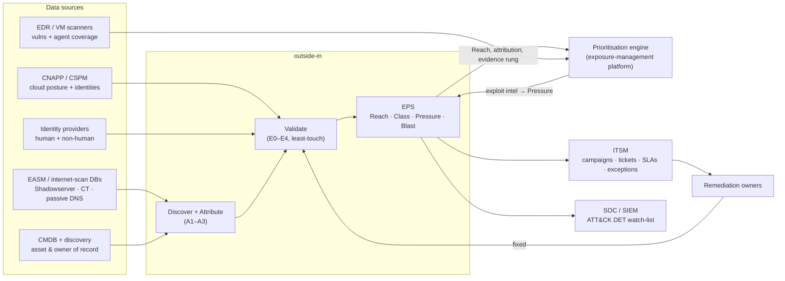

# Operating model: outside-in inside a CTEM programme

`outside-in` is not a platform. It is the **EASM-led, outside-in slice** of a Continuous Threat Exposure Management
(CTEM) programme: the part that answers *"what can an attacker reach from the internet, is it ours, and is it real?"*.
This page shows how to operationalise it alongside the tools and teams a typical enterprise already has. It is
deliberately vendor-neutral.

## 1. Where it sits

**The key handshake.** The prioritisation engine knows a lot from the *inside* (agents, authenticated scans, cloud
APIs) but usually not whether something is *actually reachable from the internet today*, *whether it is even ours*, or
*whether anyone manages it*. `outside-in` supplies exactly those three facts as attributes (Reach, attribution level,
evidence rung) and takes exploit intelligence back for the EPS Pressure factor.

## 2. Data sources and what each contributes

| Category | Contributes | Used in stage |
|---|---|---|
| **EASM / internet-scan databases** (commercial EASM, Shodan, Censys and similar) | Seeds, banners, certificates, first-seen dates (E0) | Discover |
| **Shadowserver / national CERT feeds** (free for network owners) | Daily exposed-service and vulnerable-version reports for your ranges | Discover, Validate |
| **CNAPP / CSPM** | Inside-out config truth: public buckets, open security groups, identities, "toxic combinations" | Validate (E4), Attribute |
| **EDR + VM scanners** | Installed versions, KEV/CVE matches, runtime signals, **agent health and coverage** (missing or stale agents on exposed hosts) | Prioritise (Pressure, no-EDR lift), RB-01 investigation |
| **CMDB + discovery** | Asset of record, environment, business service, remediation owner | Attribute, Mobilise |
| **Cloud org inventories** (AWS Organizations, Azure management groups, GCP org) | Accounts, tags, labels, owners | Attribute |
| **Identity providers** (human IdP, cloud IAM, CI/CD federation) | Who and what can authenticate where | RB-02 |
| **SIEM** | Audit and detection telemetry for the ATT&CK DET watch-list | Mobilise (SOC hand-off), runbooks |
| **ITSM** | Campaigns, tickets, SLAs, exceptions, change records | Mobilise, Verify-closed |

Start with what you have. The loop works on day one with passive EASM data plus a CMDB export, and gets sharper as
each source is connected.

## 3. Who does what (RACI)

| Activity | Exposure mgmt / VM team | Cloud security | SOC | Remediation owners | CISO / risk |
|---|---|---|---|---|---|
| Scope and seeds | **A/R** | C | I | I | C |
| Discover + attribute | **A/R** | C | I | C | – |
| Validate (outside-in) | **A/R** | C | I | I | – |
| Validate (inside-out, E4) | C | **R** | – | **R** | – |
| Prioritise (EPS + engine) | **A/R** | C | C | I | I |
| Mobilise: campaigns, tickets | **A/R** | C | I | **R** (fix) | I |
| Exceptions | C | C | I | **R** (raise) | **A** (approve) |
| SOC DET watch-list | C | C | **A/R** | – | I |
| Guardrails (org policy) | C | **A/R** | I | C | **A** (sponsor) |
| Verify-closed | **A/R** | C | I | I | – |
| Runbooks RB-01 / RB-02 | C | C | **R** | **R** | I (IR lead = A on compromise) |

## 4. Cadence

| When | What |
|---|---|
| **Continuously** | Feed intake (EASM alerts, Shadowserver, KEV additions). Any force-P1 goes straight to mobilisation and the relevant runbook |
| **Weekly** | Diff review (new / closed / regressed / past SLA), campaign stand-up, EPS vs engine disagreements |
| **Monthly** | Seed refresh (new domains, cloud accounts, acquisitions), exception expiry review, guardrail coverage |
| **Quarterly** | Exec brief trend, runbook exercise (tabletop RB-01 or RB-02), ATT&CK and catalog refresh after MITRE's April and October releases |

## 5. Programme metrics that matter

| Metric | Why |
|---|---|
| **Time to remove exploitable, internet-reachable exposure** (by band) | The outcome the programme exists for |
| **% KEV-listed internet-facing findings closed within SLA** | Tracks the #1 initial-access vector |
| **Regression rate** | Low regression = guardrails working |
| **Guardrail coverage** (% accounts/projects with each org-level control) | Shrinks the inflow of findings |
| **Unmanaged-asset rate** (A2 not in CMDB) | Inventory health, the root cause of most surprises |
| **Detection-gap count** (DETs the SOC can't see on exposed assets) | Converts exposure into detection engineering backlog |
| **Endpoint coverage on exposed hosts** (% with a healthy EDR agent, where one is expected) | Exposed *and* unseen is the worst combination. A simple board-level control-coverage number |

Avoid vanity counts ("CVEs closed", "mean CVSS"). They reward volume, not risk removed.
